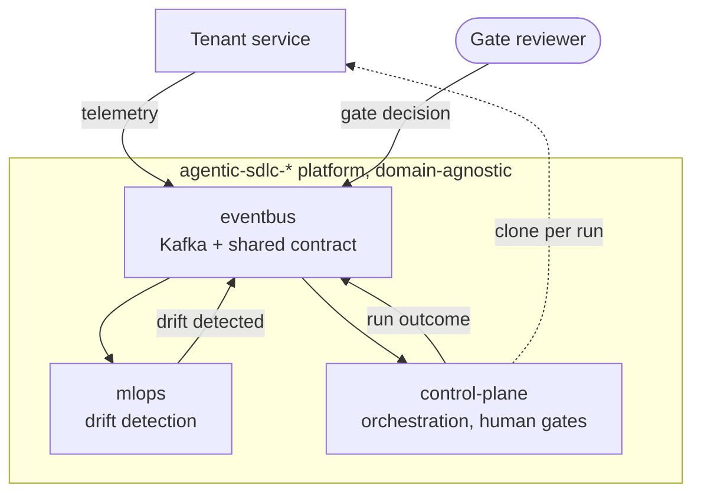

## Problem and constraint

Detect operational regressions in a running service, then orchestrate a governed, human-gated software change against that service's repository. I decomposed a monolith into four independently deployable repositories, each of which builds and runs on its own.

## Topology

Four repositories coupled only through Kafka topics and one contract package. No shared database, filesystem or compose network.

## Decisions

| Decision | Rejected alternative | Why |
|---|---|---|
| Kafka is the only coupling | Shared database between services | Each repository must start alone. A shared store hides coupling. |
| Poll loops only validate and enqueue | Run the graph inside the consumer | A gate can park a run for hours. A blocked poll loop exceeds `max.poll.interval.ms` and rebalances every other run on the partition. |
| Commit offsets on enqueue, backed by a durable `work_inbox` | Commit on completion | Committing on completion puts a clone and a full graph run back inside the poll loop. The inbox closes the loss window that early commit opens. |
| Single-threaded worker owns the checkpointer | Thread pool sharing a connection | Thread-safety stops being a question testing has to answer. Serial runs are acceptable at drift-event volume. |
| A full queue is backpressure (rewind and pause the partition) | Drop and commit past it | The original drop lost triggers with no outcome event. |
| Human gates are durable `interrupt()` suspensions in Postgres | Synchronous approval prompt | A run survives the process that started it. |
| Two audit sinks that fail differently: a hash-chained file and a Kafka topic | One append-only file | A chain proves order, not completeness. |
| Deliver only to `agentic-patch/{run_id}`, off by default | Push to the tenant's branch | Delivery needs a write-scoped token, so it is opt-in and can never touch the integration branch. |

## Results

| Check | Result |
|---|---|
| Durable gate across processes | A parked run was resumed by a *different* process after the original was killed |
| End-to-end replay run | Both gates answered, real pytest passed in 1,336 ms, `completed` |
| Live generation via the `claude` CLI | Generated 2 files in 111,875 ms; a real pytest passed in 1,609 ms; `completed`. Single run; a statistical evaluation is planned. |
| Delivery | Pushed `agentic-patch/…` with the outcome event carrying the new commit; `main` untouched |
| Audit completeness | Two consecutive runs recorded 17 records each, one continuous 34-record chain, verified across a container restart |

**Five defects were found by these real-infrastructure runs while the full unit suite passed.** The most instructive are below. Each is written up as an architecture decision record, and the platform has 29 of them.

## Failures found, and what they changed

- **An audit chain that verified while a run was missing.** The second run in a process recorded zero audit records, yet `verify_chain` reported the trail intact: the chain was whole, only short. The cursor now belongs to the run, and completeness is checked by counting records per run against runs served.
- **A listener that looked right and was not.** Reusing the host listener bootstrapped fine, then every send failed, because it advertises `localhost`. A third listener was added, and integration is now verified container-to-container in both directions.
- **A run that vanished.** An exception inside a node left the run neither resumable nor terminal. Every run now ends in exactly one reported state.
- **An oversized tracking service.** MLflow was 73% of platform memory because of a job subsystem the deployment never needed. Disabling it cut the platform to a third of its footprint.

## Limits, and what changes at 100x

- **Serial by design.** One worker runs every slice, so a long run delays decisions for others. The next step is a measured load model with a stated decision-to-resume SLO before adding workers.
- **No statistical evaluation of generated changes yet.** Live generation is evidenced by one run. A held-out task suite with confidence intervals is the planned next artifact.
- **Ongoing hardening.** An independent audit in October 2026 identified gate-decision authentication and execution isolation as the next hardening priorities; that work is in progress.

## Source

Source available on request.
