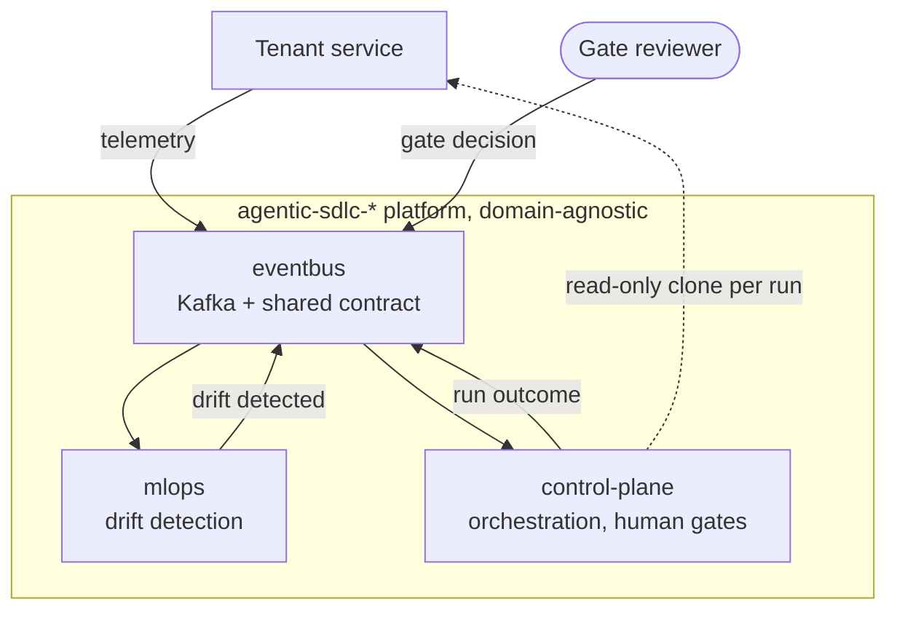

*Figures below are from the platform's system-design document, last verified 2026-07-28. Re-run before publishing.* <!-- TODO(verify): re-run suites and docker stats -->

## Problem and constraint

Detect operational regressions in a running service, then orchestrate a governed, human-gated software change against that service's repository. The starting point was a monolith. The constraint set the design: one developer, an 8 GiB Docker allocation, no GPU, and a requirement that every repository be cloneable and startable alone.

## Topology

Four repositories, coupled only through Kafka topics and one contract package. No shared database, filesystem, or compose network.

## Decisions

| Decision | Rejected alternative | Why |
|---|---|---|
| Kafka is the only coupling | Shared database between services | Each repo must start with no sibling present; a shared store hides coupling. |
| Poll loops never execute work; they validate and enqueue | Run the graph inside the consumer | A gate can park a run for hours; a blocked poll loop exceeds `max.poll.interval.ms` and rebalances every other run on the partition. |
| Single-threaded worker owns the checkpointer | Thread pool with a shared connection | Removes thread-safety as a question testing would have to answer. Serial runs are correct at this volume. |
| Work written to a `work_inbox` table before the in-memory queue | Commit offset and trust the queue | Failing to record is treated as refusal, so nothing is queued that could not be written down. |
| Full queue is backpressure (pause and rewind the partition) | Drop and commit past it | The original drop lost triggers silently with no outcome event. |
| Human gates are durable `interrupt()` suspensions in Postgres | Synchronous approval prompt | A run survives the process that started it and can be resumed by a different one. |
| Platform stays domain-agnostic, enforced by CI | Review-based convention | A convention decays; a build step does not. |
| Two audit sinks that fail differently (hash-chained JSONL + Kafka topic) | One append-only file | A chain proves order, not completeness. The independent copy is what exposes truncation. |

## Measured results

| Measure | Result |
|---|---|
| Control-plane tests | 226 passing, 91% coverage, 0 skipped in CI, gate durability against a real PostgreSQL service container |
| Contract package | 8 tests, 100% coverage, enforced in CI |
| Platform memory, all containers running | 1.03 GiB measured against 6.25 GiB of limits (16.4%) |
| Crash recovery of queued work | Container killed mid-drain: 12 of 14 queued items survived and were restored |

## Failures found, and what they changed

- **A cross-container listener that looked right and was not.** Reusing the host listener bootstrapped fine, then every send failed, because it advertises `localhost`. A third listener was added, and integration is now verified container-to-container in both directions.
- **A run that vanished.** An exception inside a node left the run neither resumable nor terminal. Every run now ends in exactly one reported state.
- **An audit chain that verified while records were missing.** A process-scoped cursor dropped every run after the first, yet `verify_chain` returned ok because the chain it checked was intact, only short. The cursor now belongs to the run, and completeness is checked by counting records per correlation id against runs served.
- **A 2 GiB service nobody used.** MLflow was 73% of platform memory because of an async job subsystem the deployment never needed. Disabling it cut the platform to a third of its footprint.
- **CI reported as delivered that had never passed.** Now only an observed-green run counts.

## Limits, and what changes at 100x

- The broker is a single node with replication factor 1, so the independent audit copy has no redundancy. Tampering is detectable only while the broker's copy exists. Production raises the replication factor first.
- The audit chain assumes one writer. A second control-plane instance would make a real alert indistinguishable from noise. Two fixes are documented (per-instance segments, or the topic as ordering authority); neither is built, and the choice depends on whether a global order is worth a broker dependency.
- Postgres is a system of record for in-flight runs with no backup prescribed.
- Code generation is unavailable in the shipped image by design; a run safe-stops with a stated reason.
- Runs execute serially. Throughput scales by adding consumers only after the audit decision above.

## Links

- [control-plane](https://github.com/jayakumar-devaraj/agentic-sdlc-control-plane) · [eventbus](https://github.com/jayakumar-devaraj/agentic-sdlc-eventbus) · [mlops](https://github.com/jayakumar-devaraj/agentic-sdlc-mlops)
<!-- TODO(verify): repo visibility, release tags, CI run URLs -->
