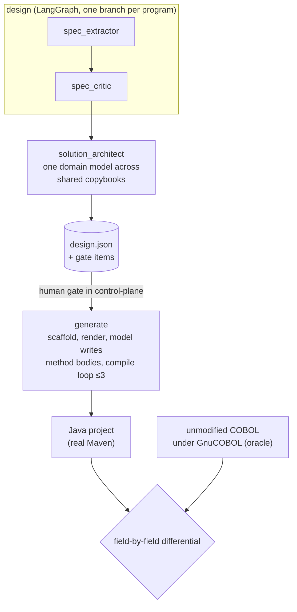

## Problem and constraint

Translate COBOL batch programs into Java, and prove the translation behaves like the original, not merely that it compiles. The source is the public CardDemo mainframe sample. The modernizer is a specialist the [platform's control plane](agentic-sdlc-platform.html) invokes as a subprocess. It has no API, no durable state and no gates of its own, so human review happens at the control plane's gates.

## Topology

Every model call goes through one client that owns backend choice, timeout, bounded retry with jittered backoff, and per-call token and cost capture.

## Decisions

| Decision | Rejected alternative | Why |
|---|---|---|
| The specialist is a subprocess, not a second control plane | Its own API, checkpointer and gates | One governance point. Duplicated gates diverge. |
| The proof is a differential against the unmodified COBOL running under GnuCOBOL | Unit tests or an LLM judge alone | The original program is a stronger instrument than any judge: it is the specification. |
| Model choice is computed per node: the cheapest catalogued model that clears the tier's bar **and has benchmark evidence for that node** | A hardcoded model per node | Adding a model to the catalogue does not make it eligible. Running the benchmark does. |
| Mark every model-written region in generated files; a compile error outside it blocks rather than going back to a model | Let the model repair anything | A reviewer can see exactly which lines a model wrote, and the model cannot "fix" the scaffold. |
| Exclude a field from comparison only with a stated reason per program | Inherit exclusions between programs | An inherited exclusion would have excused fields the second program reproduces exactly. |
| Leave RAG unwired | Wire embeddings retrieval | No one has shown retrieval helps extraction over four programs, and a third-party key would be a new dependency. No retrieval claim is made. |

## Results

**Round trips: 2 of 4 programs, with file wiring written by hand.** The qualifier goes with the number every time. A test fails if the README states the count without it.

| Program | Output compared against the COBOL oracle | Matched |
|---|---|---|
| `CBACT04C` interest calculator | interest transactions (50 records) | 500 of 500 (3 fields excluded, with reasons) |
| | rewritten account file | 597 of 600 |
| `CBTRN02C` transaction posting | transaction master (262 records) | 3,144 of 3,144 (1 field excluded) |
| | rewritten account file | 600 of 600 |
| | category balances (100 records) | 400 of 400 |

- **The 3 unmatched account fields are COBOL's own defect.** The account-break post sits in an unreachable `ELSE`, so the last account is never credited. Hiding that account would have turned the comparison green by encoding the bug, so it stays visible.
- **Both programs were measured twice:** once with scripted method bodies and once with a real `claude-opus-5` run writing them. The numbers hold for both. Both live runs compiled on the first attempt, and the repair loop never ran.
- **One calculation was checked against hand-derived values.** The `CBACT04C` interest `COMPUTE` passed an equivalence test 10 of 10, run by real Maven.
- **Model routing changed on evidence.** Both Sonnet models narrated an unreachable branch in `CBACT04C` as live, so neither is eligible for `spec_extractor`, despite being about 2.5× cheaper than Opus. `spec_critic` runs on Haiku because a benchmark showed it catches planted defects as well as Opus.

## Failures found, and what they changed

- **A comparison that failed while the translation was right.** The generated job wrote 262 transactions and 100 balance rows against an oracle holding 257 and 94. Every difference traced to amounts whose last byte is an IBM sign overpunch. GnuCOBOL read that byte as the digit 0 and dropped the sign, so a negative amount looked like a large positive one and failed a credit-limit check. Four independent lines of evidence confirmed it. The fix converts the representation inside the oracle pipeline. The oracle moved to 262 and 100, and the generated pipeline did not change.
- **A correct-looking design that was not.** `CBTRN02C` decides what to accept based on fields its own posting rewrites. A stateless implementation writes 287 records where the program writes 262. Each record is individually correct, so a field comparison cannot see the error. That was measured before the `reads_own_writes` step was built.
- **A stale "not yet done" claim.** The gap list said no real design run had happened, but real four-program runs had (about $2.31 at API rates). The entry was corrected and narrowed to what was actually still open.

## Limits

- **2 of 4 is the reachable maximum in this sense.** The other two programs only read and print. The file paths are still hand-written, because the COBOL names an environment, not a file. The claim is that *generated logic matches COBOL's own output inside wiring a human wrote*. It is not *the platform generated a working program*.
- **Output quality is spot-measured, not continuously evaluated.** An LLM-as-judge harness exists, with a committed corpus and a rubric shown to discriminate, but `solution_architect` has never been scored because no golden unified design exists to score against.
- **Nothing has been written to the real target repository yet.**

## Source

Source available on request (release v0.4.10).
