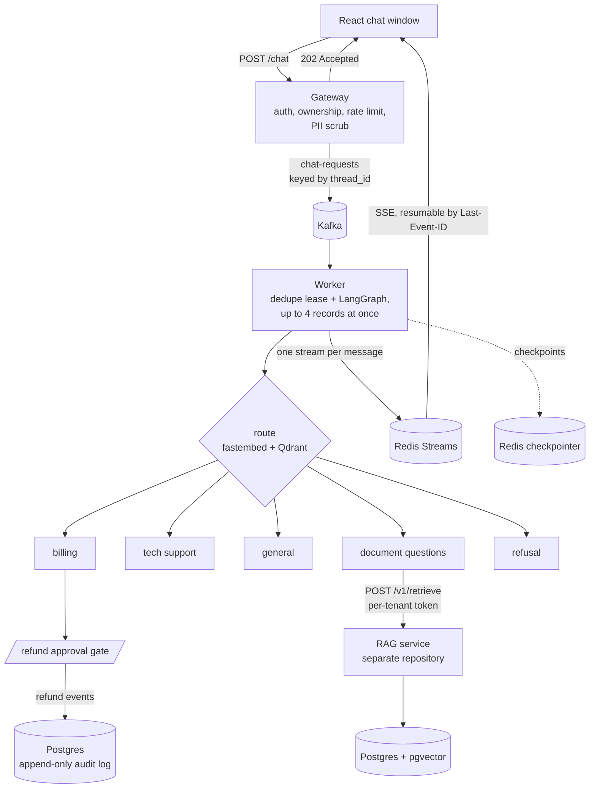

## Problem and constraint

A customer-support chatbot backend that stays responsive under load and keeps personal data out of its internals. Refunds must never be issued automatically. It uses a local model for routing and generation, so there is no per-message cost, and it answers questions about a customer's own documents through a separate retrieval service.

## Topology

Accept immediately, process asynchronously, and stream the reply back word by word. Traces go to Jaeger, AI-level spans to LangFuse, and metrics to Prometheus. The RAG service is its own case study: [RAG evaluation](rag-evaluation.html).

## Decisions

| Decision | Rejected alternative | Why |
|---|---|---|
| Answer 202 at once; deliver through a queue and a replayable stream | Synchronous request/response | No timeouts; work survives crashes and is retried or reprocessed, never lost or duplicated; gateway and worker scale independently. The cost is more moving parts. |
| Await the Kafka delivery future before answering 202; manual commits on the consumer | Fire-and-forget produce, auto-commit | "Accepted" must mean durably accepted. |
| A worker runs up to 4 records at once, but one conversation's records in order, committing offsets only below the oldest unfinished record | One record at a time | Uses the worker's CPUs without reordering a conversation or losing work in a crash. |
| One Redis Stream per message, with SSE resumable from `Last-Event-ID` | One stream per thread, or WebSockets | A reconnecting client replays exactly the message it lost; streams are capped and expire. |
| Scrub PII at the gateway, before anything enters the system, and again on output | Scrub only before the LLM call | Personal data never reaches the broker, checkpoints or traces. |
| Document questions go to a separate RAG service over a versioned HTTP contract, per tenant | Retrieval inside the worker | Each service owns its data and releases on its own; the contract is versioned (`/v1/retrieve`) and the image is pinned. |
| Refunds pause at a human approval gate, and each refund event is written to an append-only Postgres table before the user sees the outcome | Automatic refunds; audit only in Redis | Money movement needs a person, and a refund is never shown without its record. |

## Results

| Check | Result |
|---|---|
| Test suite (CI) | 278 unit, 66 integration against real Kafka, Redis, Qdrant and Postgres, 8 durability and 16 front-end tests; 95% coverage |
| Crash recovery (CI) | Worker killed three times under 300 in-flight messages, and replicas scaled 1 → 3 → 1 with one killed across 600 messages: every message finished exactly once, every conversation in order |
| Latency, mock model, open-loop load at 75% of capacity (two runs) | Queue delay p95 55 and 105 ms; `POST /chat` p95 79–95 ms; full reply p95 0.33–0.36 s |
| Safety, real model, 58 pre-registered prompts | 0 refunds applied, 0 prompt leaks, 0 of 16 canary leaks; 0 of 20 benign requests refused |
| PII, 50-sentence held-out set with targets fixed in advance | Street addresses redacted 19 of 19, up from 3 of 19; no false positives on 14 look-alike sentences |

## Failures found, and what they changed

- **A latency bottleneck that kept moving.** My first guess, the 1-CPU gateway, was wrong: the workers were pinned. Profiling then found three causes in turn, each fixed and re-measured. ONNX Runtime started one spinning thread per host core inside a 2-CPU container (queue delay p95 from 5.7 s to 0.21 s). Every request re-ran a 28 ms scrypt password check, half of the gateway's CPU (`POST /chat` p95 from 3.3 s to 0.82 s). And each worker handled one record at a time; it now runs up to four.
- **An injection detector that refuses harmless questions.** In the pre-registered safety run, 4 of 10 off-topic questions, such as a banana-bread recipe, were refused against a target of at most 1. It is reported as a fail, not tuned away.
- **A PII scrubber that missed street addresses.** A held-out set, with targets fixed before any fix was written, showed 3 of 19 addresses redacted; new recognizers raised it to 19 of 19. A defect then found in the obfuscated-email pattern was fixed only after fresh test cases were registered, so the fix was not tuned on the set that found it.

## Limits

- **Real-model throughput is set by the model server.** On 4 CPUs, a 1B local model gave 0.18–0.24 turns per second at every concurrency tried; more worker concurrency only moves the wait into the model server.
- **Detection quality.** Harmless off-topic questions are refused, and some obfuscated identifiers still slip through the scrubber.
- **Reply quality with a 1B local model** averaged 3.4 of 5 on 20 questions, scored by the build agent rather than independently.
- **An edge in the approval flow.** A new message while a refund awaits approval abandons the paused refund. It is audited, but the user must ask again.
- **Scrubbed prompts leave the machine** to LangFuse Cloud, so the runtime is not fully offline.
- **No deployment target yet.** There is no production hosting.

## Source

[enterprise-agentic-event-driven-chatbot on GitHub](https://github.com/jayakumar-devaraj/enterprise-agentic-event-driven-chatbot), with the measurement reports in [`docs/reports/`](https://github.com/jayakumar-devaraj/enterprise-agentic-event-driven-chatbot/tree/main/docs/reports).
