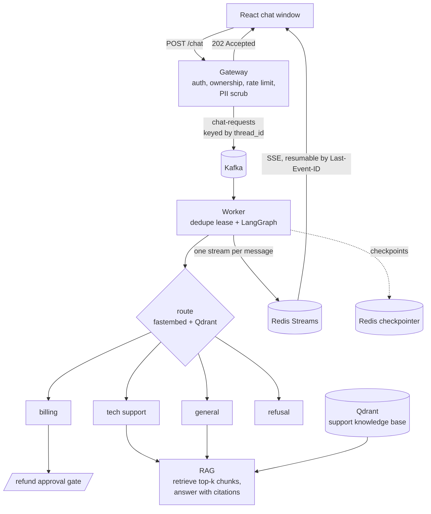

## Problem and constraint

A customer-support chatbot backend that stays responsive under load and keeps personal data out of its internals. Refunds must never be issued automatically. It uses a local model for routing and generation, so there is no per-message cost.

## Topology

Accept immediately, process asynchronously, and stream the reply back word by word. Traces go to Jaeger locally and LangFuse for AI-level spans.

## Decisions

| Decision | Rejected alternative | Why |
|---|---|---|
| Answer 202 at once; deliver through a queue and a replayable stream | Synchronous request/response | No timeouts; work survives crashes and is retried or reprocessed, never lost or duplicated; gateway and worker scale independently. The cost is more moving parts. |
| Await the Kafka delivery future before answering 202; manual commits on the consumer | Fire-and-forget produce, auto-commit | "Accepted" must mean durably accepted. |
| One Redis Stream per message, with SSE resumable from `Last-Event-ID` | One stream per thread, or WebSockets | A reconnecting client replays exactly the message it lost; streams are capped and expire. |
| Scrub PII at the gateway, before anything enters the system, and again on output | Scrub only before the LLM call | Personal data never reaches the broker, checkpoints or traces. |
| Routing and injection thresholds set by leave-one-out calibration, with the rule fixed before the eval file was used | Hand-picked thresholds | Ties go to the safe side: uncertain input routes to `general`, and false refusals are minimised. |
| Refunds pause at a human approval gate, bound to the thread owner | Automatic refunds | Money movement needs a person. |

## Results

| Check | Result |
|---|---|
| Test suite | 67 unit, 19 integration tests against the real broker, database and vector store, and 5 front-end tests, passing locally and in CI; 88% coverage |
| Horizontal scale | 2 gateways and 2 workers: turns posted alternately across gateway replicas, each stream read on the other replica, ordered with no duplicates; both workers owned partitions with zero lag |
| Latency at 20 concurrent users (mock LLM, 200 requests) | `POST /chat` p50 3,545 ms, p95 4,822 ms; first token p50 4,443 ms, p95 6,807 ms. |
| PII scrub | 5.72 ms p95. Recall 100% on a 32-sentence sample that is too easy to support a real-world claim. |
| Real model round trip | Completed with a local Ollama model; HTTPS through a Caddy reverse proxy |

## Failures found, and what they changed

- **A latency hypothesis that turned out wrong.** I expected the 1-CPU gateway to be the bottleneck. Sampling `docker stats` showed the *workers* pinned at their 2-CPU cap while gateways stayed under 100%. A second cause was in the async Kafka producer: its defaults buffer messages in Python for up to 1 s before librdkafka sees them. The obvious fix (`buffer_timeout=0`) broke delivery outright, so it was reverted, and the next experiments are written down in order. No fix has shipped yet.
- **An injection detector that refuses a legitimate customer.** At the calibrated threshold, "How do I get my money back for this charge?" scores above the line. It was reported, not tuned away; structural prompt separation remains the primary defence.
- **A small model echoing the prompt delimiters.** `llama3.2:1b` repeated the user block at the start of its reply. The echo is now filtered on output but not yet re-tested against the model.

## Limits, and what changes at 100x

- **Latency has a measured cause but no fix.** At 100x, worker CPU per message is the first constraint. The plan: profile output scrubbing and embedding threads, then scale workers toward the partition count.
- **PII recall is unproven on hard text.** A realistic, adversarial labelled set comes before any accuracy target.
- **An edge in the approval flow.** A new message on a thread while a refund awaits approval abandons the paused run. It fails safe, but the user must ask again.
- **Scrubbed prompts leave the machine** to LangFuse Cloud, so the runtime is not fully offline.
- **No deployment target yet.** There is no image registry or production hosting.

## Source

Source available on request.
