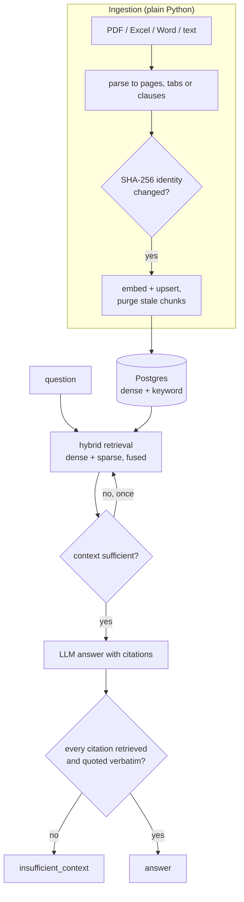

## Problem and constraint

Retrieval-augmented answers are only useful if they are grounded: the cited source must be the one the answer used, and the system must decline rather than guess. Both builds were time-boxed, so evaluation had to be cheap, honest about sample size, and built into the run from the start.

## Topology

## The two systems

| | agentic-poly-rag | Contract clause assistant |
|---|---|---|
| Purpose | Multi-tenant RAG over PDF, Excel (every tab) and Word | Answers about a contract portfolio, citing the exact clause |
| Retrieval | pgvector + `pg_trgm`/full-text in one Postgres | Keyword + dense, fused (RRF) |
| Self-correction | LangGraph loop: one bounded re-query, then a fallback, never a guess | Answer released only if every citation names a retrieved clause and quotes it verbatim |
| Models | Groq `gpt-oss-120b`; local MiniLM embeddings | Groq primary, Gemini fallback |

## Decisions

| Decision | Rejected alternative | Why |
|---|---|---|
| One Postgres for the dedup registry and the vectors | A separate vector database | The hash gate, the diff, the purge and the insert commit in one transaction. |
| Change detection by content hash, keyed by tenant and page or tab, not filename | Re-ingest everything, or key by filename | A renamed file with one changed row must replace the old chunk, not sit beside it. |
| A deterministic citation guard decides release; the LLM judge only reports | Trust the model's citations | A verbatim-quote check cannot be talked out of its answer. |
| Exactly one bounded re-query hop | An open-ended agent loop | Bounded cost and latency; failure is an explicit fallback. |
| Thresholds and eval rules fixed before scoring | Tune until the numbers look good | Otherwise the evaluation measures the tuning. |

## Results

**Contract clause assistant**, golden set of 9 questions over 4 synthetic contracts (7 answerable, 2 not):

| Metric | Result |
|---|---|
| Retrieval recall@5 | 7 of 7 |
| Citation accuracy | 7 of 7 |
| Answered when answerable, declined when not | 9 of 9 |
| Retrieval latency, p50 / max | 160.8 ms / 268.9 ms |
| End-to-end answer latency, max | 1,775 ms |

The RAGAS scores are reported but treated only as a smoke test. 9 of 21 judge calls timed out, so faithfulness rests on 2 questions. The deterministic checks above and the verbatim-citation guard are the primary grounding evidence.

**agentic-poly-rag**, three scenarios run against the real system:

| Scenario | Result |
|---|---|
| Two Excel tabs with the same row label and different values | Cited the correct tab; groundedness 1.0 |
| A renamed PDF with one changed value | Answered the new value only. The old chunk was purged, not supplemented. |
| A multi-hop question across 2 of 7 tabs (5 distractors) | Combined both and computed the correct product. The re-query hop was *not* exercised by this data; that path is verified separately by an integration test. |

## Failures found, and what they changed

- **A vector index that sometimes found nothing.** An `ivfflat` index built on an empty table with 100 lists, searched with the default single probe, made dense retrieval non-deterministic at demo volumes. Identical content and query found both pages on one run and none on the next. It was replaced with HNSW, which has no empty-table sizing problem.
- **Deduplication that broke on rename.** Including the filename in the identity key made a renamed, edited file look like an unrelated document. Identity is now (tenant, page or tab). The documented cost: two unrelated documents from one tenant that share a page label now collide.

## Limits

- **The samples are synthetic and small.** 9 golden questions and 3 scenarios show the mechanics work. They are not a benchmark, and no accuracy claim is made beyond them.
- **The LLM judge is unreliable under rate limits.** Timeouts left most faithfulness rows unscored. A larger, paired evaluation with confidence intervals is the next step.
- **Scope cuts from the time box are recorded.** For example, Word ingestion reads paragraphs only.

## Source

Source available on request.
