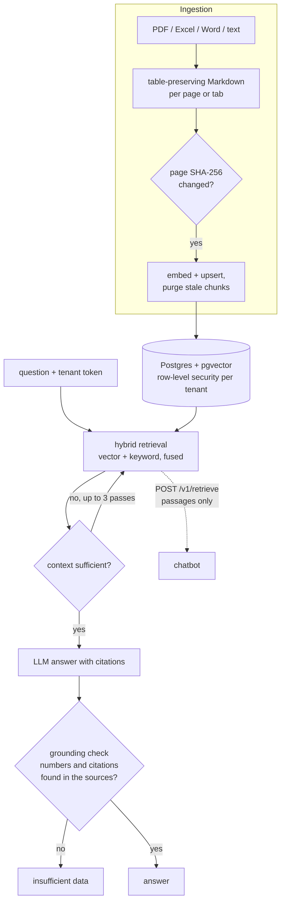

## Problem and constraint

Retrieval-augmented answers are only useful if they are grounded: the cited source must be the one the answer used, and the system must decline rather than guess. Both systems started as time-boxed builds, so evaluation was built in from the start. The multi-tenant service was then hardened into a service other applications call, where one customer's documents must never reach another.

## Topology

## The two systems

| | multi-tenant-agentic-rag | Contract clause assistant |
|---|---|---|
| Purpose | Multi-tenant RAG service over PDF, Excel (every tab) and Word; also answers the chatbot's document questions | Answers about a contract portfolio, citing the exact clause |
| Retrieval | Vector and keyword search in one SQL statement, fused with reciprocal rank fusion; the tenant is enforced in the query and again by row-level security | Keyword + dense, fused (RRF) |
| Self-correction | LangGraph loop: up to 3 retrieval passes, then a decline; an answer quoting a number not found in the sources is blocked | Answer released only if every citation names a retrieved clause and quotes it verbatim |
| Models | Groq primary, OpenAI fallback; local fastembed embeddings | Groq primary, Gemini fallback |
| Operations | Signed-token auth with search and upload scopes, per-tenant rate and document limits, an audit trail, Prometheus metrics, a published container image | — |

## Decisions

| Decision | Rejected alternative | Why |
|---|---|---|
| One Postgres for the change registry and the vectors | A separate vector database | The hash gate, the purge and the insert commit in one transaction, so stale figures cannot linger. The cost is a lower scale ceiling, roughly a million chunks. |
| Change detection by content hash per page or tab, with document identity from page-hash overlap, not filename | Re-ingest everything, or key by filename | A renamed file with one changed row must replace the old chunk, not sit beside it. |
| Tenant isolation twice: a filter in every query and row-level security in the database | The query filter alone | A missed filter in code cannot leak another tenant's data. A benchmark on 20,000 chunks across 20 tenants found no measurable overhead. |
| A deterministic grounding check decides release; the LLM judge only reports | Trust the model's citations | A check against the source text cannot be talked out of its answer. |
| A bounded re-query loop, then an explicit decline | An open-ended agent loop | Bounded cost and latency; failure is an answer, not a guess. |
| Evaluation targets, data and labels fixed and pushed before any run | Tune until the numbers look good | Otherwise the evaluation measures the tuning. |

## Results

**multi-tenant-agentic-rag**, pre-registered evaluation on 8 synthetic documents (26 sections) and 30 hand-labelled questions:

| Measure | Result |
|---|---|
| Retrieval recall@5 (target 0.80) | 0.90: identifier and table lookups 1.0, paraphrases 0.87, two-part questions 0.75 |
| `/v1/retrieve` p95, sequential, without the model call (target 2 s) | 54–60 ms over three runs |
| Groundedness | Not measured: no model key was available for the run, so it is reported as not run |
| Three demonstration scenarios, live with a real model | All correct and cited: an exact invoice ID, a renamed PDF with one changed row, and a cross-document comparison |
| Test suite (CI) | 151 tests, 41 of them against real Postgres with pgvector; 93% coverage |

**Contract clause assistant**, golden set of 9 questions over 4 synthetic contracts (7 answerable, 2 not):

| Metric | Result |
|---|---|
| Retrieval recall@5 | 7 of 7 |
| Citation accuracy | 7 of 7 |
| Answered when answerable, declined when not | 9 of 9 |
| Retrieval latency, p50 / max | 160.8 ms / 268.9 ms |
| End-to-end answer latency, max | 1,775 ms |

The RAGAS scores are reported but treated only as a smoke test. 9 of 21 judge calls timed out, so faithfulness rests on 2 questions. The deterministic checks above and the verbatim-citation guard are the primary grounding evidence.

## Failures found, and what they changed

- **A rate limit that forgot refused calls.** An independent audit inferred that a refused call's count rolled back with its transaction. An integration test against real Postgres reproduced it first, storing 2 calls where 5 were made, and the fix moved the refusal after the commit.
- **A document cap that parallel uploads could pass.** With a cap of 2 and one document held, 6 parallel uploads all committed. Each tenant's uploads are now serialized, and the same test proves the cap holds.
- **Retrieval misses reported, not tuned.** Two paraphrased questions missed their section entirely, and two more were found only at rank 5, which the service's default of 4 misses on the first pass. Nothing was changed in response, so the score still describes the system as it is.

## Limits

- **The samples are synthetic and small.** 30 questions over 26 sections and a 9-question golden set show the mechanics work. The questions were written by the code's author, so they may be easier than real use. They are not a benchmark, and no accuracy claim is made beyond them.
- **Groundedness is unmeasured in the latest evaluation,** and the LLM judge was unreliable under rate limits in the earlier one.
- **Identity and deployment.** Signed tokens are tested with generated keys, not a production identity provider, and the published image has no deployment target yet.
- **Scale.** A single Postgres trades scale, roughly a million chunks, for transactional updates.

## Source

[multi-tenant-agentic-rag on GitHub](https://github.com/jayakumar-devaraj/multi-tenant-agentic-rag), with the evaluation in [`docs/reports/`](https://github.com/jayakumar-devaraj/multi-tenant-agentic-rag/tree/main/docs/reports). The contract clause assistant's source is available on request.
